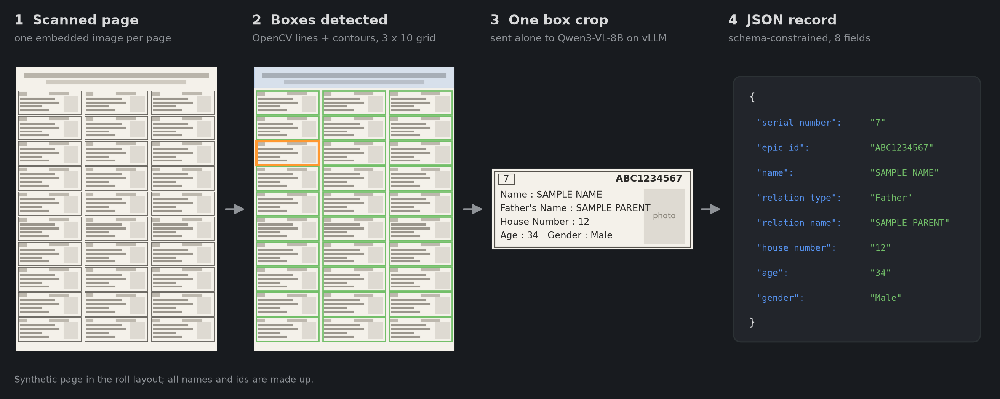
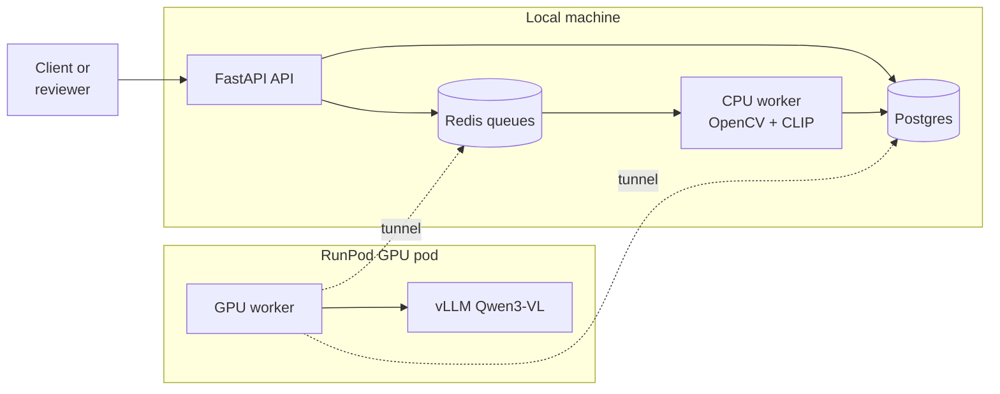
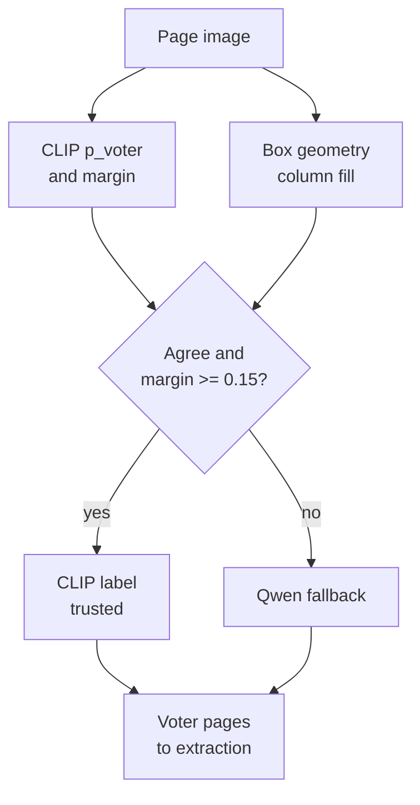
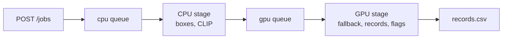
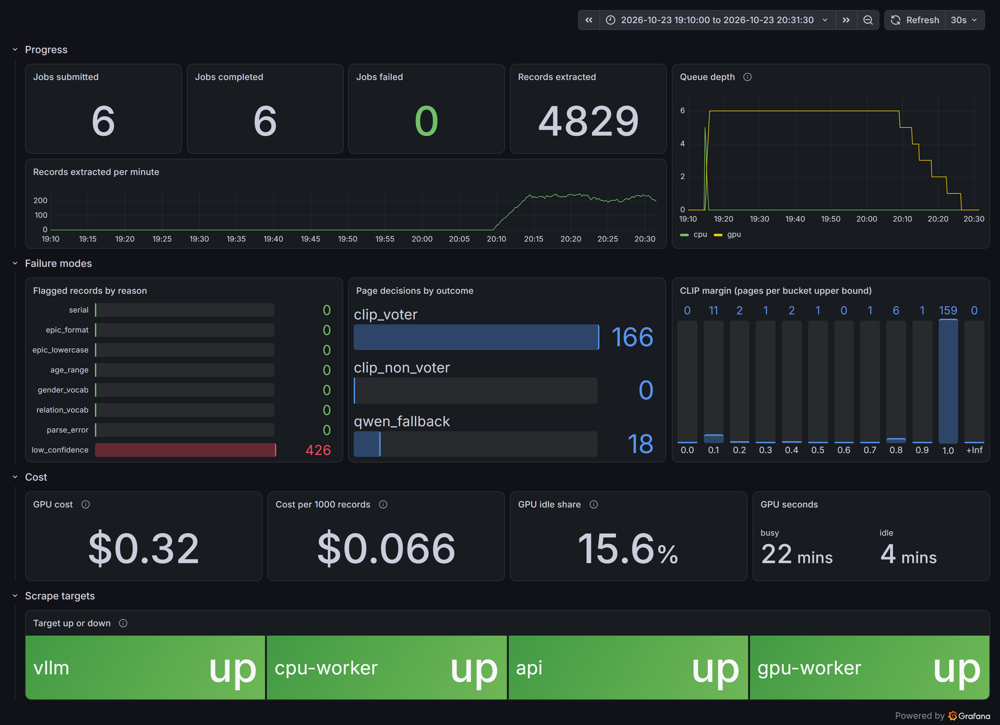
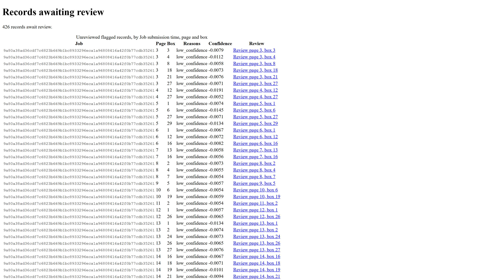
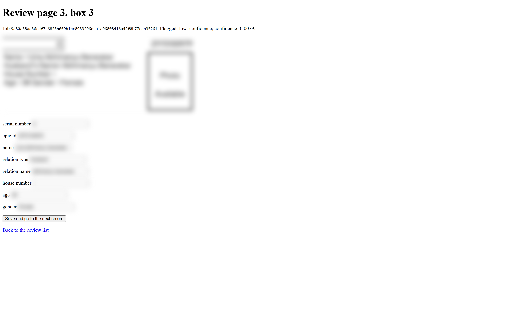

# Scanned electoral rolls to voter CSV: 99.66% field accuracy with Qwen3-VL-8B on one RTX 4090

[](https://github.com/neha-nambiar/qwen-structured-extraction/actions/workflows/ci.yml)
[](https://github.com/neha-nambiar/qwen-structured-extraction/actions/workflows/release.yml)

eroll converts scanned Indian electoral-roll PDFs into a CSV with eight fields per voter. On **4,829 hand-checked records** (6 PDFs, 184 pages) it reaches **99.66% field accuracy** and **97.78% record accuracy**, with **0 voter pages dropped** and 0 parse failures, at **0.252 s per record** and **$0.052 per 1,000 records** on one rented RTX 4090. It runs as a deployed service: an API, two queue stages, PostgreSQL, a review page for flagged records, Prometheus and Grafana, and a GPU pod that deletes itself when idle.



## Highlights

- **Constrained extraction.** Each voter box is sent to Qwen3-VL-8B as its own request and decoded against a JSON schema. 130 of 38,632 fields are incorrect; serial number and age have no errors, and 88% of the errors are in free-text names.
- **No voter page lost.** A cascade of CLIP and box geometry decides 90% of pages on the CPU and sends the rest to Qwen. CLIP alone would have trusted 6 non-voter pages as voter pages; geometry vetoed all of them, and the final page label was wrong 0 times in 184.
- **GPU time is the only rented resource.** The stateful services run locally and reach the GPU pod over an SSH tunnel. Extraction costs $0.052 per 1,000 records, and the pod deletes itself after 15 idle minutes.

## Problem and output

Each page of a roll PDF is one embedded scan. A voter page is a grid of up to 30 bordered boxes in 3 columns and up to 10 rows; cover, map and summary pages carry no voter records. The output is one record per box in a fixed schema, written to CSV. The synthetic box in the figure above becomes:

```json
{
  "serial number": "7", "epic id": "ABC1234567", "name": "SAMPLE NAME",
  "relation type": "Father", "relation name": "SAMPLE PARENT",
  "house number": "12", "age": "34", "gender": "Male"
}
```

## Architecture

The stateful services (API, CPU worker, PostgreSQL, Redis, Prometheus, Grafana) run locally in Docker Compose. Only the GPU work runs on a RunPod RTX 4090 pod, which exposes nothing but SSH. The tunnel carries Redis and PostgreSQL to the pod and brings vLLM and GPU worker metrics back to Prometheus.



Every page is classified twice: CLIP zero-shot on the CPU, and box geometry (column fill, the median box width over one third of the page width). The CLIP label is kept only when both agree and the margin is at least 0.15. Every other page goes to Qwen, which is constrained to answer `voter` or `non_voter`.



| Piece | Choice |
|---|---|
| Box detection | OpenCV adaptive threshold, line morphology and contours; no learned components, every threshold relative to page size |
| Page classifier | CLIP ViT-B/32 zero-shot, trusted at margin ≥ 0.15 when it agrees with geometry (column fill ≥ 0.92); otherwise Qwen |
| Extraction | `Qwen3-VL-8B-Instruct` in bf16 on vLLM, one request per box, temperature 0, up to 32 requests in flight |
| Output constraints | JSON schema decoding: EPIC id pattern, enums for gender and relation type, digit patterns for serial number and age |
| Service | FastAPI, RQ on Redis (`cpu` and `gpu` queues), PostgreSQL with Alembic; the job id is the PDF's SHA-256 |
| GPU hosting | RunPod RTX 4090, SSH only; the pod deletes itself after 15 idle minutes |
| Monitoring | Prometheus scraping the API, CPU worker, GPU worker and vLLM; one provisioned Grafana dashboard |
| CI and release | GitHub Actions: ruff, pytest and `alembic check` on every push; `v*` tags build and push the CPU and GPU images to GHCR |

Job sequence, API, database schema, record lifecycle and configuration: [docs/architecture.md](docs/architecture.md).

## Results

All figures are from one benchmark run over the 4,829 hand-checked records ([docs/benchmarks.md](docs/benchmarks.md)).

| Measure | Result |
|---|---|
| Field accuracy (8 fields, 38,632 fields) | **99.66%** |
| Record accuracy (all 8 fields correct) | **97.78%** |
| Parse failures | 0 |
| Voter pages whose detected box count equals the true record count | 166 of 166 |
| Speed at 32 requests in flight | 0.252 s per record (3.97 records/s) |
| GPU cost at $0.74/h | $0.052 per 1,000 records |

Field errors by field: serial number 0, epic id 2, name 70, relation type 4, relation name 44, house number 8, age 0, gender 2.

Page classification:

| True class | Pages | Decided by | Final label wrong |
|---|---|---|---|
| voter | 166 | CLIP, trusted | 0 |
| non-voter | 18 | Qwen fallback | 0 |

No voter page was dropped. CLIP chose "voter" for 15 of the 18 non-voter pages, 6 of them with a margin above 0.15; a CLIP-only rule would have trusted those 6, and the geometry check vetoed each one. Column fill separates the classes: 0.940 to 0.945 on voter pages, at most 0.908 on non-voter pages. The 0.15 threshold was fitted on a separate calibration set of 60 PDFs from 8 constituencies (1,744 pages) that shares no file with the test set, with 0 wrongly trusted pages in either class ([docs/calibration.md](docs/calibration.md)).

Throughput and cost against concurrency, same records and GPU:

| Requests in flight | s per record | $ per 1,000 records | Field errors |
|---|---|---|---|
| 8 | 0.373 | 0.077 | 127 |
| 16 | 0.256 | 0.053 | 129 |
| 32 | 0.252 | 0.052 | 130 |

## Production service

A job moves through two queue stages. The CPU stage decodes every page, detects boxes, classifies the page with CLIP and stores the result; the GPU stage reads only what the CPU stage stored, runs the Qwen fallback, extracts records one page per commit, and computes review flags.



Identical uploads map to a single job, a failed job resumes from its last stored page when resubmitted, and a voter page with grid problems fails the job instead of being dropped silently.

Verified live run of the deployed service on 2026-10-23: 6 PDFs, 184 pages (166 voter pages trusted from CLIP, 18 sent to Qwen), 4,829 records and 0 failed jobs. With the confidence threshold at -0.005, 426 records were flagged `low_confidence`. The pod was busy for approximately 22 minutes and idle for 4, predominantly during model loading. The dashboard reports $0.32 of GPU time, $0.066 per 1,000 records at the pod's rate of $0.89/h; the benchmark's $0.052 counts busy time only, at $0.74/h.



*Figure 1. Grafana dashboard after the live run: progress, failure modes, cost and scrape targets.*

Flagged records are listed for human review. Each record opens with its box crop beside an edit form; saved corrections are append-only and applied to the CSV, and the raw model output remains available with `?raw=1`. Voter data in the screenshots is blurred.



*Figure 2. Review list: unreviewed flagged records, oldest job first.*



*Figure 3. Review page: box crop, extracted fields and flag reasons for one record.*

The GPU worker checks once a minute and deletes its pod through the RunPod API after 15 idle minutes. Model loading, a failed vLLM probe and a lost tunnel all count as idle time, so a disconnected pod also shuts itself down. Each `v*` tag builds the CPU and GPU images in GitHub Actions and pushes them to GHCR; the pod launches from the tagged image.

## Key engineering findings

1. **Structural validators cover the fields with the fewest errors.** 88% of field errors are names and relation names, and an incorrectly read name passes every structural check. Confidence is the remaining per-record signal, but the mean token log probability falls in a narrow band from -0.0190 to -0.0002, because tokens forced by the schema (braces, keys) dilute the few tokens that carry the name. A threshold in that band flags either a negligible share of records or a large share of correct records ([findings/confidence.md](findings/confidence.md)).
2. **Box geometry acts as a veto on CLIP.** CLIP processes the page at 224 x 224, a resolution at which a cover or summary page resembles a voter grid. Column fill measures the property that separates the classes, and the two checks fail in different ways. The threshold is fitted for the pair, not for CLIP alone ([findings/page_classification.md](findings/page_classification.md)).
3. **The GPU saturates at 16 requests in flight.** Increasing from 8 to 16 reduces time per record by 31%; increasing to 32 reduces it by a further 1.7%, because additional requests only wait in vLLM's queue. Field errors stay at 127 to 130 across the three settings, which is the run-to-run noise floor ([findings/concurrency.md](findings/concurrency.md)).

## Limitations

- The ground truth is 6 PDFs from 2 constituencies in one roll format.
- Each benchmark configuration and the service run were run once.
- The confidence threshold is not calibrated against the scored mistakes; -0.005 was a setting for the live run.
- 18 non-voter pages is a small sample for the Qwen fallback (18 of 18 correct).
- Box detection and the 0.92 column-fill cut-off are measured on one layout (3 columns, up to 10 rows); a new format requires re-measuring and refitting.

## Repository layout

| Path | Contents |
|---|---|
| `src/eroll/pages/` | PDF image extraction, box detection, CLIP and geometry classifier |
| `src/eroll/extraction/` | Record schema, prompt, vLLM requests, validators |
| `src/eroll/service/` | FastAPI app, review pages, RQ jobs, workers, metrics |
| `src/eroll/evaluation/` | Benchmark run, scorer, ground-truth check, CLIP calibration |
| `deploy/` | Dockerfiles, compose stack, Prometheus, Grafana, pod launch and tunnel scripts |
| `migrations/` | Alembic migration |
| `tests/` | Unit tests |
| `docs/` | Architecture, benchmark and calibration reports, screenshots |
| `findings/` | One write-up per experiment |
| `.github/workflows/` | CI and release |

## Reproduce

Requires Python 3.12, [uv](https://docs.astral.sh/uv/), Docker and, for the GPU side, a RunPod account. The deploy scripts are PowerShell.

```powershell
cp .env.example .env    # replace every change-me value
# load .env into the shell (launch_pod.ps1 reads RUNPOD_API_KEY, PUBLIC_KEY and GHCR_OWNER from it)
Get-Content .env | ? { $_ -match '^[A-Z_]+=' } | % { $k,$v = $_ -split '=',2; Set-Item "env:$k" $v }

# local stack: API on 127.0.0.1:8080, CPU worker, Redis, Postgres, Prometheus, Grafana on :3000
docker compose --env-file .env -f deploy/docker-compose.yml up -d --build

# submit a PDF, poll it, download the CSV
curl.exe -H "X-API-Key: $env:API_KEY" -F "file=@roll.pdf" http://127.0.0.1:8080/jobs
curl.exe -H "X-API-Key: $env:API_KEY" http://127.0.0.1:8080/jobs/<job id>
curl.exe -H "X-API-Key: $env:API_KEY" -o roll.csv http://127.0.0.1:8080/jobs/<job id>/records.csv

# GPU worker (starts billing), then the tunnel with the IP and port it prints
deploy/launch_pod.ps1 -Tag v3.0.0 -Mode worker
deploy/tunnel.ps1 -PodIp <ip> -Port <port> -IdentityFile <ssh key>
```

Pages are classified locally on upload; the GPU worker drains the `gpu` queue once the tunnel is up. To benchmark, launch with `-Mode eval -LifetimeMinutes 90`, run `python -m eroll.evaluation.run_local bench-32 data/pdfs/*.pdf` on the pod, copy `out/eval-bench-32` back and run `uv run python -m eroll.evaluation.score bench-32`, which writes the benchmark report. Rolls, ground truth and outputs contain personal data and are not in the repository.

## Credits

Model: [Qwen3-VL-8B-Instruct](https://huggingface.co/Qwen/Qwen3-VL-8B-Instruct) (Alibaba Qwen), served with [vLLM](https://github.com/vllm-project/vllm). Page classifier: [OpenAI CLIP](https://github.com/openai/CLIP). Built with [OpenCV](https://opencv.org/), [PyMuPDF](https://github.com/pymupdf/PyMuPDF), [FastAPI](https://fastapi.tiangolo.com/), [RQ](https://python-rq.org/), [PostgreSQL](https://www.postgresql.org/), [Prometheus](https://prometheus.io/), [Grafana](https://grafana.com/) and [RunPod](https://www.runpod.io/).

MIT license, see [LICENSE](LICENSE).
