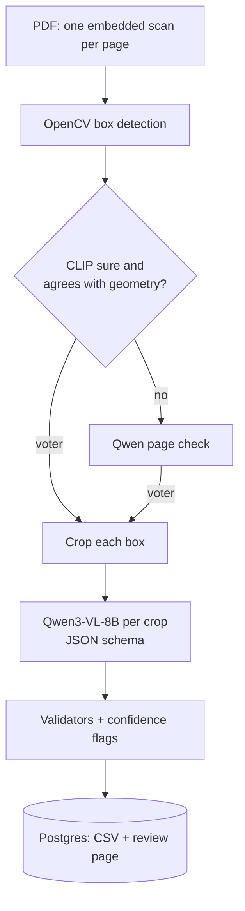
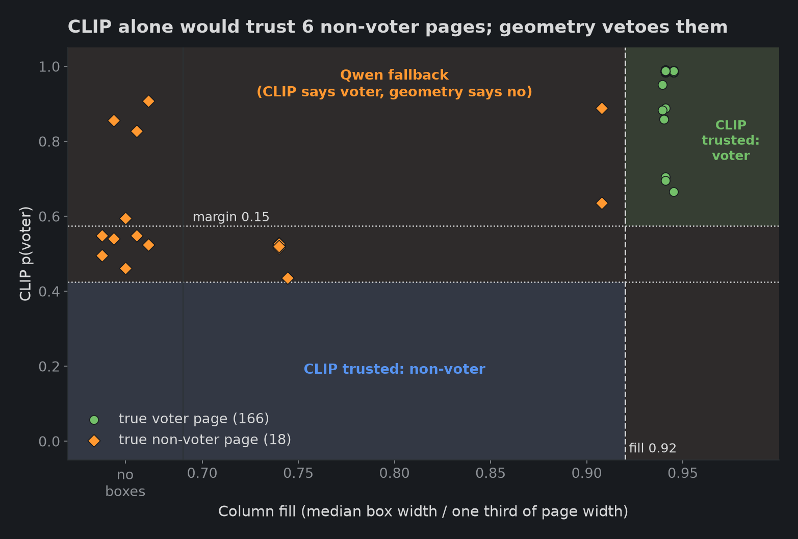
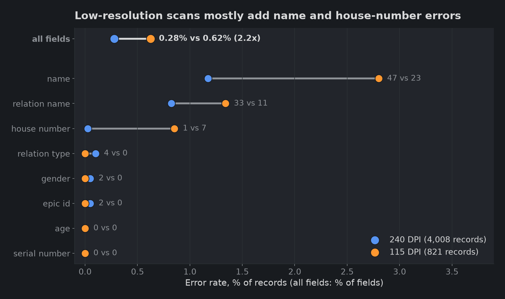

# Scanned electoral rolls to voter CSV: 99.66% field accuracy with Qwen3-VL-8B on one RTX 4090

[](https://github.com/neha-nambiar/qwen-structured-extraction/actions/workflows/ci.yml)
[](https://github.com/neha-nambiar/qwen-structured-extraction/actions/workflows/release.yml)

eroll turns scanned Indian electoral-roll PDFs into a CSV with eight fields per voter. On **4,829 hand-checked records** (6 PDFs, 184 pages) it reaches **99.66% field accuracy** and **97.78% record accuracy**, with **0 voter pages dropped** and **0 parse failures**, at **0.252 s per record** and **$0.052 per 1,000 records**. It runs as a real service: queues, a database, a human review page, live cost on a Grafana dashboard, and a GPU pod that deletes itself when idle.


**Highlights**

- **Accurate where it counts.** 130 wrong fields out of 38,632. Serial number and age were never wrong; 88% of the errors are names.
- **No voter page lost.** A CLIP + box-geometry cascade decides about 90% of pages on the CPU and sends the rest to Qwen. CLIP called 15 of 18 non-voter pages "voter"; geometry vetoed every one, and the final page label was wrong 0 times out of 184.
- **Cheap to run.** 5 cents per 1,000 records of GPU time on one rented RTX 4090. Only the GPU work is rented, and the pod deletes itself after 15 idle minutes.
- **A service, not a notebook.** FastAPI, Redis queues, PostgreSQL, a review page for flagged records, Prometheus and Grafana, and CI-built images. The deployed service scores 99.65% field accuracy, matching the in-process benchmark.

## The task

Input: a roll PDF where every page is one embedded scan, and a voter page is a grid of up to 30 bordered boxes. Output: one record per box, read into a fixed JSON schema and written to CSV. The synthetic example above becomes:

```json
{
  "serial number": "7", "epic id": "ABC1234567", "name": "SAMPLE NAME",
  "relation type": "Father", "relation name": "SAMPLE PARENT",
  "house number": "12", "age": "34", "gender": "Male"
}
```

## How it works



| Piece | Choice |
|---|---|
| Box detection | OpenCV adaptive threshold, line morphology and contours; no learned parts, all thresholds relative to page size |
| Page classifier | CLIP ViT-B/32 zero-shot, trusted only at margin ≥ 0.15 and agreeing with box geometry (column fill ≥ 0.92); anything else goes to Qwen |
| Extraction | `Qwen3-VL-8B-Instruct` in bf16 on vLLM, one request per box, temperature 0, up to 32 in flight |
| Output constraints | JSON schema decoding: EPIC id pattern, enums for gender and relation type, digit patterns for serial and age |
| Service | FastAPI, RQ on Redis (`cpu` and `gpu` queues), PostgreSQL with Alembic; a job id is the PDF's SHA-256 |
| GPU hosting | RunPod RTX 4090, SSH only; a tunnel carries Postgres and Redis to the pod; the pod deletes itself after 15 idle minutes |
| Monitoring | Prometheus scraping API, CPU worker, GPU worker and vLLM; one provisioned Grafana dashboard |
| CI / release | GitHub Actions: ruff, pytest and `alembic check` on every push; `v*` tags build and push the CPU and GPU images to GHCR |

System diagrams, job sequence, API, database schema and configuration: [docs/architecture.md](docs/architecture.md).

## Results

| Measure | Result |
|---|---|
| Field accuracy (all 8 fields, 4,829 records) | **99.66%** |
| Record accuracy (all 8 fields right) | **97.78%** |
| Page labels wrong / voter pages dropped | 0 of 184 / 0 of 166 |
| Detected boxes = true records | 166 of 166 voter pages |
| CLIP threshold errors on a separate 1,744-page calibration set | 0 |
| Speed | 0.252 s per record (3.97 records/s) |
| GPU cost | $0.052 per 1,000 records at $0.74/h |



CLIP alone would have trusted 6 non-voter pages as voter pages; column fill separates the classes cleanly (voter 0.940 to 0.945, non-voter at most 0.908).


Names and relation names are 114 of the 130 errors. Schema-constrained fields are almost never wrong.


Going from 8 to 16 requests in flight cuts time per record by 31%; 32 adds only 1.7% more.



115 DPI scans have 2.2x the field error rate of 240 DPI scans (0.62% vs 0.28%).

Full reports: [docs/benchmarks.md](docs/benchmarks.md), [docs/calibration.md](docs/calibration.md), and one write-up per topic in [findings/](findings/).

## Running it for real


One live run of the deployed service: 6 PDFs, 184 pages (166 voter pages trusted from CLIP, 18 sent to Qwen), 4,829 records and 0 failed jobs. With the confidence threshold set to -0.005, 426 records were flagged `low_confidence` for review. The pod was busy for about 22 minutes and idle for 4 (mostly model load); the dashboard shows $0.32 of GPU time, $0.066 per 1,000 records at that pod's $0.89/h rate.

Flagged records land in a review list. Each one opens with its box crop beside an edit form; saved corrections are applied to the CSV, and the raw model output stays available. Voter data is blurred in the record screenshot.


## What I learned

1. **Validators guard the fields that are already right.** 88% of errors are names, and a misread name passes every structural check. Confidence is the only per-record signal left, but the mean token log probability sits in a band from -0.0190 to -0.0002, because schema tokens (braces, keys) dilute the few tokens that carry the name.
2. **Use geometry as a veto on CLIP.** At 224 x 224 pixels a cover or summary page looks like a voter grid to CLIP. Box width measures exactly what separates the classes, and the two fail in different ways. The threshold is fitted for the pair, on 1,744 pages that share no file with the test set.
3. **The GPU saturates at 16 requests in flight.** Beyond that, extra requests only queue inside vLLM. Accuracy stays flat at 127 to 130 field errors across 8, 16 and 32, which is the run-to-run noise floor.
4. **Scan resolution sets the error floor.** Every crop is upscaled to the same 1,066 prompt tokens, but a 115 DPI box has about 300 real pixels of width against about 620 at 240 DPI. Names roughly double their error rate, and house numbers go from 1 error to 7.

## Limits

- The ground truth is 6 PDFs from 2 constituencies in one roll format; the low-resolution sample is a single 31-page PDF (821 records).
- Each benchmark configuration and the service run were run once.
- The confidence threshold is not calibrated. -0.005 was a setting for the live run; in such a narrow band a threshold either flags almost nothing or many correct records.
- 18 non-voter pages is a small sample for the Qwen fallback (18 of 18 correct).
- Box detection and the 0.92 geometry cut-off are measured on this layout (3 columns, up to 10 rows); a new format needs re-measuring and refitting.

## Repository

| Path | What it is |
|---|---|
| `src/eroll/pages/` | PDF image extraction, box detection, CLIP + geometry classifier |
| `src/eroll/extraction/` | record schema, prompt, vLLM requests, validators |
| `src/eroll/service/` | FastAPI app, review pages, RQ jobs, workers, metrics |
| `src/eroll/evaluation/` | benchmark run, scorer, ground-truth check, CLIP calibration |
| `deploy/` | Dockerfiles, compose stack, Prometheus, Grafana, pod launch and tunnel scripts |
| `migrations/` | Alembic database migration |
| `tests/` | unit tests |
| `docs/` | architecture, benchmark and calibration reports, screenshots |
| `findings/` | one write-up per experiment, with charts |
| `.github/workflows/` | CI and release |

## Reproduce

Needs Python 3.12, [uv](https://docs.astral.sh/uv/), Docker and, for the GPU side, a RunPod account. The deploy scripts are PowerShell.

```powershell
cp .env.example .env    # replace every change-me value
# load .env into the shell (launch_pod.ps1 reads RUNPOD_API_KEY, PUBLIC_KEY and GHCR_OWNER from it)
Get-Content .env | ? { $_ -match '^[A-Z_]+=' } | % { $k,$v = $_ -split '=',2; Set-Item "env:$k" $v }

# local stack: API on 127.0.0.1:8080, CPU worker, Redis, Postgres, Prometheus, Grafana on :3000
docker compose --env-file .env -f deploy/docker-compose.yml up -d --build

# submit a PDF, poll it, download the CSV
curl.exe -H "X-API-Key: $env:API_KEY" -F "file=@roll.pdf" http://127.0.0.1:8080/jobs
curl.exe -H "X-API-Key: $env:API_KEY" http://127.0.0.1:8080/jobs/<job id>
curl.exe -H "X-API-Key: $env:API_KEY" -o roll.csv http://127.0.0.1:8080/jobs/<job id>/records.csv

# GPU worker (starts billing), then the tunnel with the IP and port it prints
deploy/launch_pod.ps1 -Tag v3.0.0 -Mode worker
deploy/tunnel.ps1 -PodIp <ip> -Port <port> -IdentityFile <ssh key>
```

Pages are classified locally right away. The GPU worker loads the model, probes vLLM, checks the database schema before its first job (Postgres is only reachable once the tunnel is up), then drains the `gpu` queue. To benchmark, launch with `-Mode eval -LifetimeMinutes 90`, run `python -m eroll.evaluation.run_local bench-32 data/pdfs/*.pdf` on the pod, copy `out/eval-bench-32` back and run `uv run python -m eroll.evaluation.score bench-32`, which writes the benchmark report. Rolls, ground truth and outputs hold personal data and are not in the repo. Details: [docs/architecture.md](docs/architecture.md).

## Credits

Model: [Qwen3-VL-8B-Instruct](https://huggingface.co/Qwen/Qwen3-VL-8B-Instruct) (Alibaba Qwen), served with [vLLM](https://github.com/vllm-project/vllm). Page classifier: [OpenAI CLIP](https://github.com/openai/CLIP). Built with [OpenCV](https://opencv.org/), [PyMuPDF](https://github.com/pymupdf/PyMuPDF), [FastAPI](https://fastapi.tiangolo.com/), [RQ](https://python-rq.org/), [PostgreSQL](https://www.postgresql.org/), [Prometheus](https://prometheus.io/), [Grafana](https://grafana.com/) and [RunPod](https://www.runpod.io/).

MIT license, see [LICENSE](LICENSE).
