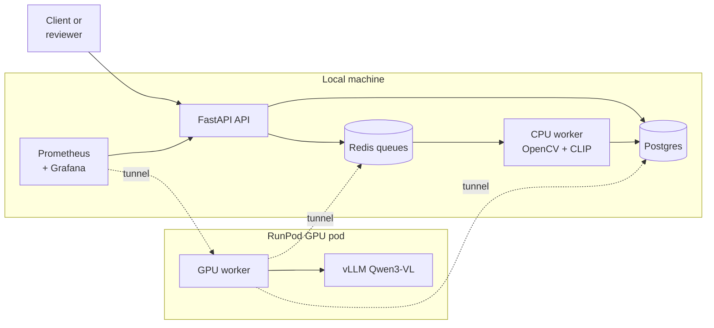
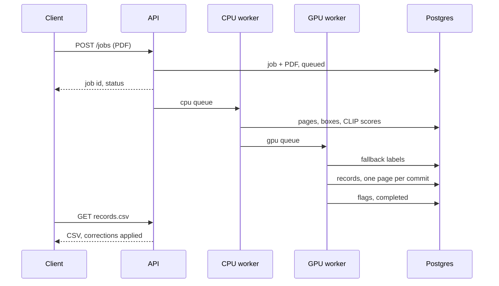
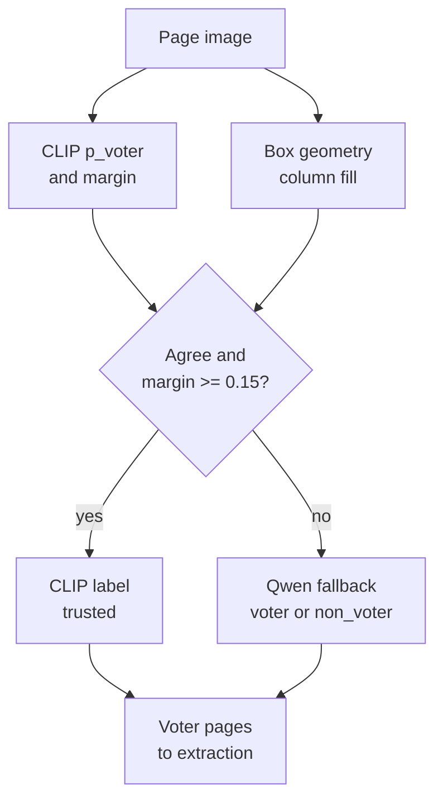
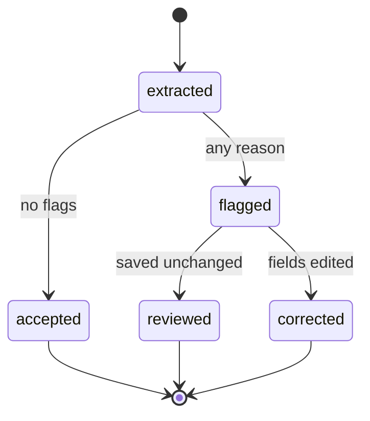
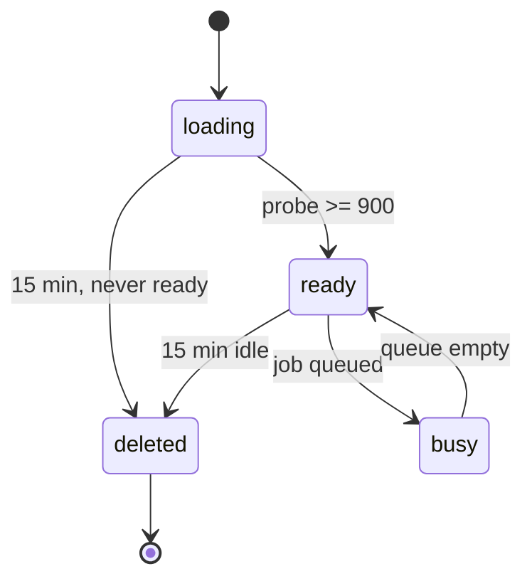
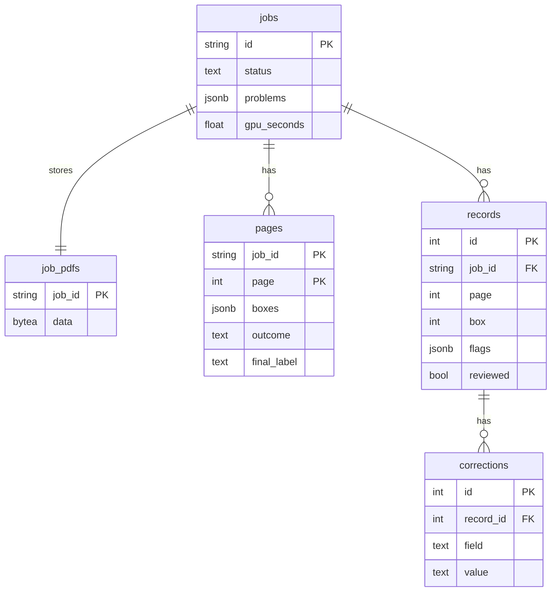

# Architecture

eroll is split into two parts. The stateful services (API, CPU worker, Postgres, Redis, Prometheus, Grafana) run locally in Docker Compose. Only the GPU work runs on a rented RunPod pod (RTX 4090), which exposes nothing but SSH. An SSH tunnel carries Redis and Postgres to the pod and brings vLLM and GPU worker metrics back to Prometheus. Every published compose port binds `127.0.0.1`.

## System view

| Component | Code | Role |
|---|---|---|
| API | `src/eroll/service/api.py` | Upload, job status, CSV download, review UI, `/metrics`. API key on every route. |
| CPU worker | `src/eroll/service/workers.py`, `jobs.py` | `cpu_stage`: decode pages, detect boxes, classify pages with CLIP. |
| GPU worker | same files | `gpu_stage`: Qwen fallback, record extraction, flags. Deletes its pod after 15 idle minutes. |
| vLLM | `deploy/gpu-entrypoint.sh` | Serves Qwen3-VL-8B-Instruct in bfloat16, `max-model-len` 1536, `min_pixels` 802,816, `max_pixels` 1,310,720, on pod loopback only. |
| Postgres | `migrations/` | Jobs, PDFs, page images, records, review corrections. |
| Redis + RQ | | Two queues, `cpu` and `gpu`. |
| Prometheus + Grafana | `deploy/prometheus.yml`, `deploy/grafana/` | Scrapes 4 targets (API, CPU worker, vLLM, GPU worker) every 15 s. One provisioned dashboard. |

The tunnel has two reverse forwards (pod `127.0.0.1:6379` and `:5432` to the local Redis and Postgres) and two local forwards (local `18000` and `19102` to vLLM and GPU worker metrics on the pod). Prometheus reaches the local forwards as `host.docker.internal`. With the tunnel closed, both pod targets are reported as down.

## Job sequence

A job moves through two queue stages. The CPU stage stores every page with its boxes and CLIP scores, then hands the job to the GPU queue. The GPU stage only reads what the CPU stage stored.

- The job id is the SHA-256 of the PDF, so identical uploads map to a single job. The PDF is checked to open with PyMuPDF before anything is stored.
- Re-uploading a failed PDF requeues `cpu_stage`, which re-analyses every page, so fallback pages are classified by Qwen again. `gpu_stage` then skips pages that already have records and resumes extraction where it stopped. Records are unique on `(job_id, page, box)`.
- A voter page with grid problems fails the job instead of being dropped silently. The CPU stage collects every CLIP-trusted voter page with problems into one error; the GPU stage fails on a fallback page that Qwen labels voter and that has grid problems.
- `GET /jobs/{id}/records.csv` returns 409 until the job is completed.

## Page decision

Every page is classified twice: CLIP zero-shot on the CPU, and box geometry (median box width over one third of the page width). CLIP's label is kept only when both agree and the margin is large enough. All other pages go to Qwen.

- The geometry label is voter when column fill is at least 0.92 (`MIN_COLUMN_FILL_RATIO`); a page with no detected boxes is non-voter. The width test, not the box count, decides, so a voter page with a missed box stays a voter page and fails with an explicit error.
- CLIP receives the page padded to a white square, because its processor would otherwise remove the header and footer by centre-cropping.
- The 0.15 margin threshold was fitted on a separate calibration set (60 PDFs, 1,744 pages).
- The fallback sends the page downscaled to a 1,280 px longest edge and constrains the answer to `voter` or `non_voter`.

## Extraction

- Each box is cropped with a 2% inset per edge and sent as its own request: JSON schema decoding, temperature 0, at most 200 new tokens, token log probabilities on. Up to `MAX_CONCURRENT_REQUESTS` (default 32) requests are in flight across page boundaries.
- The schema pins `epic id` to `^([A-Z]{3}[0-9]{7})?$`, serial number and age to digits, and `gender` and `relation type` to enums. Names and house numbers stay free text.
- vLLM is pinned to `min_pixels` 802,816, which gives each crop approximately 1,066 prompt tokens. Once vLLM reports healthy, the GPU worker sends a synthetic 300x100 probe image; under 900 prompt tokens means `min_pixels` is being ignored (approximately 352 tokens), and the worker then accepts no jobs.
- Requests are not retried (`max_retries=0`). A failed request fails the job, which resumes from the last stored page when resubmitted.
- A dash-only house number is stored as empty.

## Record lifecycle

Flags are computed after all pages of a job are extracted, because the serial check counts on from the job's first record. In the database, `reviewed` and `corrected` are both `reviewed = true`; a corrected record also has rows in `corrections`. Corrections are append-only. The CSV applies the latest correction per field; `?raw=1` returns the stored model output.

| Flag reason | Raised when |
|---|---|
| `serial` | the serial is not exactly the job's first serial plus the record's position |
| `epic_format` | the EPIC id is not 3 ASCII letters + 7 digits |
| `epic_lowercase` | the format is right but the letters are not upper case |
| `age_range` | age is not a whole number from 18 to 120 |
| `gender_vocab` | gender is not male or female (any case) |
| `relation_vocab` | relation type is not husband, father, mother or others (any case) |
| `parse_error` | the reply held no JSON object |
| `low_confidence` | mean token log probability is below `CONFIDENCE_THRESHOLD` (only when it is set) |

Serial gaps between consecutive voter pages are recorded as job problems, next to any error problem.

## GPU pod lifecycle

The worker checks once a minute. Its idle timer starts when the worker process starts, so vLLM loading counts as idle time, and the pod deletes itself if vLLM is not ready within 15 minutes. A failed probe, a lost tunnel (Redis or Postgres unreachable) and an unhealthy vLLM all count as idle time, so a disconnected pod still shuts itself down. Deletion goes through the RunPod REST API and is retried every minute until it returns 2xx; if the worker process exits, the entrypoint retries the delete itself. In eval mode the pod runs vLLM without a worker and deletes itself after `-LifetimeMinutes` (default 120).

## Database schema

One Alembic migration. The API and CPU worker exit at start unless the database is at the head revision; the GPU worker checks before its first job, because Postgres is only reachable once the tunnel is up.

`jobs` also holds `page_count`, `submitted_at` and `updated_at`; `gpu_seconds` adds the wall time of each successful `gpu_stage` call. `pages` also holds the embedded scan, its size, the geometry label, both CLIP probabilities, the margin and grid problems. `records` holds the 8 fields, the mean token log probability and the raw text of an unparsable reply.

## API

All routes need the API key, as an `X-API-Key` header or as the password of HTTP Basic auth (the review pages in a browser, and Prometheus). The API refuses to start with a key shorter than 32 characters. OpenAPI docs are disabled.

| Method and path | Purpose |
|---|---|
| `POST /jobs` | Upload a PDF (multipart `file`). Returns id and status. 413 above `MAX_UPLOAD_BYTES`, 422 if not a readable PDF. Re-uploading a failed job retries it; any other existing job returns its current status. |
| `GET /jobs/{id}` | Status, per-page decisions, problems, record and flagged counts, GPU seconds. |
| `GET /jobs/{id}/records.csv` | Records with corrections applied; `?raw=1` for uncorrected output. 409 until completed. |
| `GET /review` | Unreviewed flagged records, oldest job first, then page and box. |
| `GET /review/{record_id}` | Edit form with the box crop. |
| `GET /review/{record_id}/crop.png` | Lossless crop, sent with `Cache-Control: no-store`. |
| `POST /review/{record_id}` | Save changed fields, mark reviewed, redirect to the next unreviewed record. |
| `GET /metrics` | Prometheus metrics. |

## Monitoring

| Metric | Type | Labels |
|---|---|---|
| `eroll_jobs_submitted_total` | counter | |
| `eroll_jobs_finished_total` | counter | `status`: completed, failed |
| `eroll_records_extracted_total` | counter | |
| `eroll_page_decisions_total` | counter | `outcome`: clip_voter, clip_non_voter, qwen_fallback |
| `eroll_clip_margin` | histogram | buckets 0.0 to 1.0 by 0.1 |
| `eroll_record_confidence` | histogram | buckets -1 to 0, dense near 0 |
| `eroll_flagged_records_total` | counter | `reason`: the 8 flag reasons |
| `eroll_stage_seconds` | histogram | `stage`: cpu_stage, gpu_stage, clip, fallback, extract_page |
| `eroll_gpu_seconds_total` | counter | `state`: busy, idle |
| `eroll_hourly_usd` | gauge | |
| `eroll_queue_depth` | gauge, read from Redis per scrape (API only) | `queue`: cpu, gpu |

Every process serves the full metric set: the API on `/metrics`, the CPU worker on `:9101` (compose network only), the GPU worker on pod loopback `:9102`. Labels only take values from fixed sets, never job ids or field values. vLLM's own serving metrics are scraped as well.

The Grafana dashboard has four rows:

- Progress: jobs submitted, completed and failed, records extracted, records per minute, queue depth.
- Failure modes: flagged records by reason, page decisions by outcome, CLIP margin histogram.
- Cost: GPU cost, cost per 1,000 records, GPU idle share, busy and idle GPU seconds.
- Scrape targets: up or down for the API, CPU worker, vLLM and GPU worker.

## Configuration

Settings are read from the environment or `.env` (see `.env.example`). Invalid settings exit with status 2 and log the setting name, never its value; each entry point also exits with status 2 if a setting it needs is missing.

| Key | Default | Used by |
|---|---|---|
| `LOG_LEVEL` | `INFO` | all |
| `DATABASE_URL` | none; required by the API, workers and Alembic | API, workers, Alembic |
| `REDIS_URL` | none; required by the API and workers | API, workers |
| `API_KEY` | none, at least 32 characters | API, Prometheus scrape |
| `POSTGRES_PASSWORD`, `REDIS_PASSWORD` | none, required | docker-compose containers |
| `GRAFANA_ADMIN_PASSWORD` | none, required | docker-compose Grafana |
| `VLLM_BASE_URL` | `http://127.0.0.1:8000/v1` | GPU worker, run_local |
| `VLLM_MODEL` | `Qwen/Qwen3-VL-8B-Instruct` | GPU worker, run_local, pod entrypoint |
| `MAX_CONCURRENT_REQUESTS` | `32` (1 to 256) | GPU worker, run_local |
| `REQUEST_TIMEOUT_SECONDS` | `120` | GPU worker, run_local |
| `CONFIDENCE_THRESHOLD` | unset, no confidence flags; at most 0 | GPU worker |
| `MAX_UPLOAD_BYTES` | `209715200` (200 MiB) | API |
| `HOURLY_USD` | `0.74` | GPU worker metrics, score.py |
| `RUNPOD_POD_ID`, `RUNPOD_API_KEY` | none; RunPod sets the pod id | GPU worker and pod entrypoint, for self-deletion |
| `GHCR_OWNER` | none | launch_pod.ps1 |
| `PUBLIC_KEY` | none | launch_pod.ps1, written to the pod's `authorized_keys` |
| `POD_MODE`, `EVAL_LIFETIME_MINUTES` | `worker`, `120` | pod entrypoint, set by launch_pod.ps1 |

## Security notes

- Every compose port binds `127.0.0.1`. The pod exposes only SSH, with the key from `PUBLIC_KEY`; the tunnel accepts a new pod's host key on first use. vLLM has no API key and listens on pod loopback only.
- The API uses one shared key, compared in constant time, over plain HTTP. It must be placed behind a TLS reverse proxy before it is exposed beyond localhost.
- The pod receives `RUNPOD_API_KEY` (for self-deletion) and, in worker mode, `DATABASE_URL` and `REDIS_URL` with their passwords as environment variables. launch_pod.ps1 never prints them and redacts them from error messages.
- The review crop is sent with `Cache-Control: no-store`, since it shows a voter's details.
- Rolls, ground truth, outputs and `.env` are git-ignored and excluded from Docker images. Logs and error messages name files, pages and boxes, not field values. The one exception is `check_truth --crop`, which prints one ground-truth name so a crop can be checked by eye.
