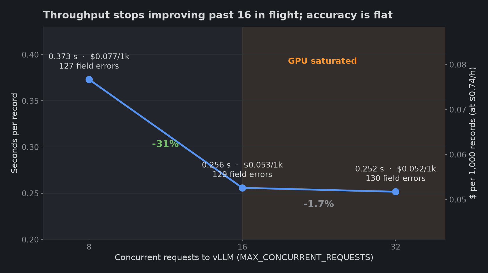

# Concurrency: throughput saturates at 16 requests in flight

## Summary

The same 4,829 records on the same RTX 4090 were extracted at three `MAX_CONCURRENT_REQUESTS` settings. Going from 8 to 16 requests in flight cut the time per record by 31%. Going from 16 to 32 cut it by only 1.7% more. Accuracy did not change in any meaningful way. Each setting was run once.

| Concurrency | Wall clock | s per record | Records/s | $ per 1,000 records | Field errors | Field accuracy | Record accuracy |
|---|---|---|---|---|---|---|---|
| 8 | 1801.6 s | 0.373 | 2.68 | 0.077 | 127 | 99.67% | 97.87% |
| 16 | 1235.5 s | 0.256 | 3.91 | 0.053 | 129 | 99.67% | 97.80% |
| 32 | 1215.0 s | 0.252 | 3.97 | 0.052 | 130 | 99.66% | 97.78% |

Cost assumes $0.74 per GPU hour. The wall clock covers the Qwen page fallback, extraction and CSV writing; CLIP runs before the timer starts.

## Why it saturates

Every box is its own request: one crop of about 1,066 prompt tokens (almost all of it image tokens) and a JSON answer capped at 200 tokens. vLLM batches whatever requests are in flight. At 8, the batch is too small to keep the GPU busy, so adding requests adds throughput almost for free. By 16 the GPU is the bottleneck, and extra requests only wait in vLLM's queue. 32 is the default: it is no slower than 16 and leaves headroom while the next page is decoded and cropped.

Requests are not limited per page. A semaphore caps the number in flight across page boundaries, and crops for the next page are pulled only when a slot frees up. So the GPU never idles at the end of a page waiting for its last box, and memory stays bounded to a few decoded pages.

## Accuracy is flat

Decoding is greedy (temperature 0) with a JSON schema, so in principle the answers should not depend on concurrency. In practice the three runs differ by 127 to 130 field errors. Different batch shapes change the floating-point maths slightly, and a near-tie between two tokens can flip. A spread of about 3 fields in 38,632 is the run-to-run noise floor for these numbers; differences smaller than that should not be read as real.
