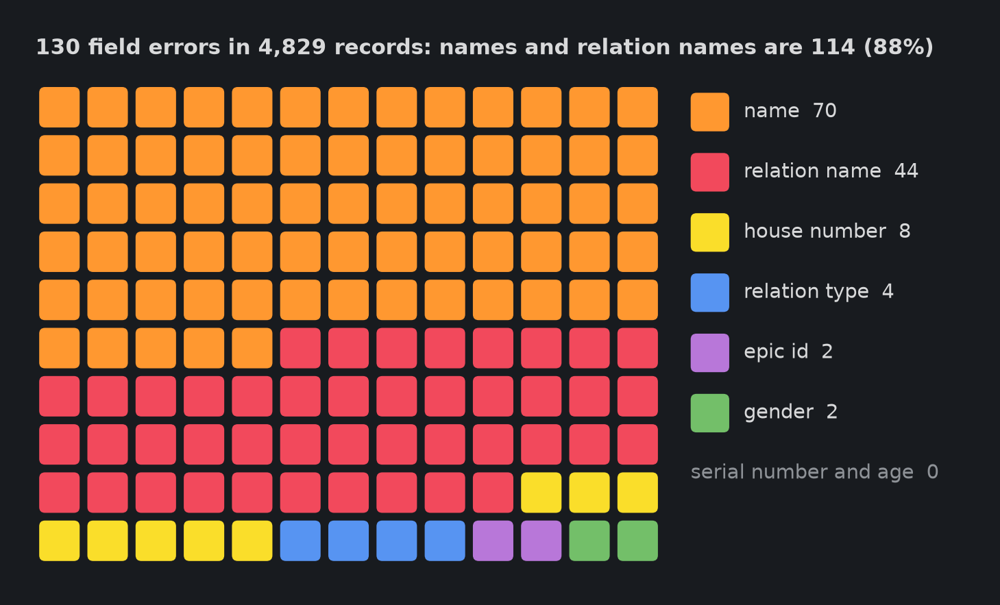

# Field errors: almost all are names

## Summary

On the 4,829 ground-truth records (run at 32 concurrent requests), 130 of 38,632 fields were wrong, spread over 107 records. Names and relation names account for 114 of the 130 errors (88%). Serial number and age were never wrong. Field accuracy is 99.66% and record accuracy (all 8 fields right) is 97.78%.

| Field | Errors | Accuracy |
|---|---|---|
| serial number | 0 | 100.00% |
| epic id | 2 | 99.96% |
| name | 70 | 98.55% |
| relation type | 4 | 99.92% |
| relation name | 44 | 99.09% |
| house number | 8 | 99.83% |
| age | 0 | 100.00% |
| gender | 2 | 99.96% |

A field counts as correct when it matches the hand-corrected value after trimming whitespace and ignoring case. A dash-only house number counts as empty on both sides.

## Why the errors cluster in names

The extraction request uses constrained decoding with a JSON schema. Serial number and age must be 1 to 5 and 1 to 3 digits, the EPIC id must be 3 capital letters and 7 digits, and gender and relation type are enums. The model cannot emit a malformed value for these fields, and the printed values are short and high-contrast, so they are nearly always right.

Names and relation names are free text with no pattern to lean on. They are the longest fields, often unfamiliar spellings, and a single wrong letter makes the whole field wrong. The same holds for house numbers, which mix digits, letters and words.

## What it means for review

The structural validators (serial sequence, EPIC format, age range, gender and relation vocabulary) catch exactly the kinds of fields that are already almost always right. A misread name passes every check, so the 114 name errors are not flagged for review. Catching them needs a per-record signal from the model itself, which is what the confidence threshold is for. On average a wrong record has 1.2 wrong fields, so errors are mostly isolated rather than whole records going bad.
