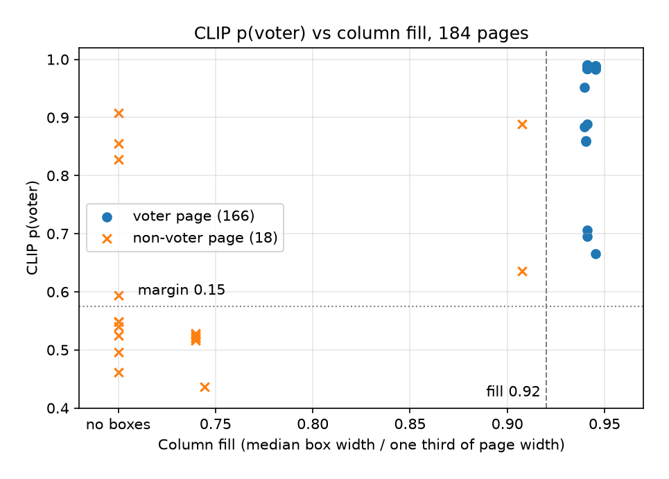

# Page classification: CLIP alone is insufficient, geometry corrects it

## Summary

On the 184 ground-truth pages (166 voter, 18 non-voter), the final page label was wrong 0 times and no voter page was dropped. Every voter page was trusted from CLIP with a margin of at least 0.332 (median 0.973). Every non-voter page went to the Qwen fallback, and Qwen labelled all 18 correctly. CLIP on its own would have produced serious errors: it chose "voter" for 15 of the 18 non-voter pages, 6 of them with a margin above the 0.15 threshold. The box-geometry check vetoed all 6.

Each point is one page. The dotted line is p(voter) = 0.575, where the margin reaches 0.15; the dashed line is the 0.92 column-fill cut-off. A CLIP-only rule trusts everything above the dotted line as voter, which includes 6 non-voter pages. All 6 lie left of the dashed line, so geometry vetoes them. Pages with no detected box are drawn at "no boxes".

## How a page is decided

Each page is classified twice. CLIP ViT-B/32 compares the page with two voter and two non-voter text prompts and gives p(voter), p(non-voter) and their margin. Separately, box detection measures column fill: the median detected box width over one third of the page width. Geometry says voter at 0.92 or more. The CLIP label is trusted only if the margin is at least 0.15 and CLIP agrees with geometry. Anything else goes to Qwen3-VL, which sees the page shrunk to a 1,280 px longest edge and must answer `voter` or `non_voter`.

| Ground truth | Pages | Outcome | Final label wrong |
|---|---|---|---|
| voter | 166 | all trusted from CLIP | 0 |
| non-voter | 18 | all sent to Qwen | 0 |

The 18 fallback pages split into two kinds:

- 15 pages where CLIP said voter but geometry said non-voter. Their margins range up to 0.815. The 6 above 0.15 would have been trusted as voter pages by a CLIP-only rule.
- 3 pages where CLIP agreed with geometry but was unsure, with margins of 0.008, 0.076 and 0.128.

## Why CLIP is fooled and geometry is not

CLIP looks at the whole page shrunk to 224 x 224 pixels. At that size a cover page with bordered blocks, or a summary page full of table cells, can resemble a grid of voter boxes. The prompts are zero-shot and were not tuned on these pages, so CLIP cannot distinguish the two.

Geometry measures exactly the property that separates the classes. Voter boxes span 0.940 to 0.945 of a column on every voter page. Table cells on non-voter pages are narrower: 10 non-voter pages had no box-sized rectangle at all, and the other 8 had a column fill between 0.740 and 0.908. The two checks fail in different ways, which is why the combination works.

## Caveats

The 18 non-voter pages are a small sample: 18 of 18 correct shows the fallback works on these pages, not that it never fails. The ground truth takes true labels from position (pages 1, 2 and the last page are non-voter), which holds for this roll format. 9.78% of pages went to the fallback here, close to the 11.07% seen on the calibration set.
